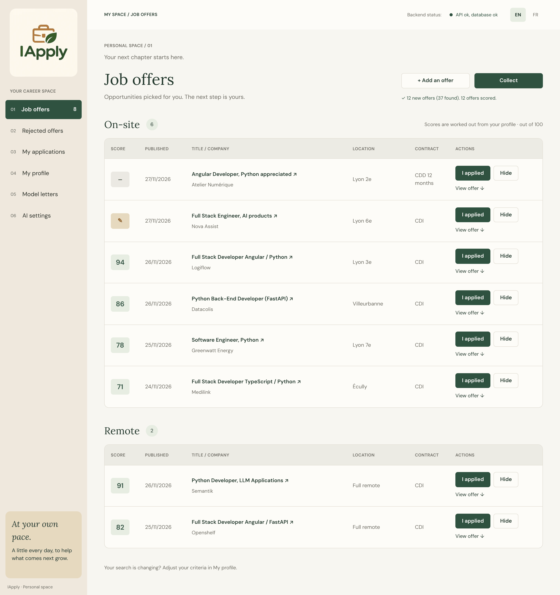
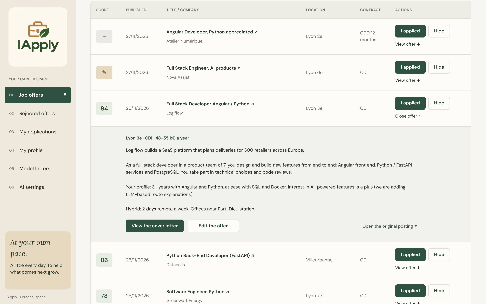
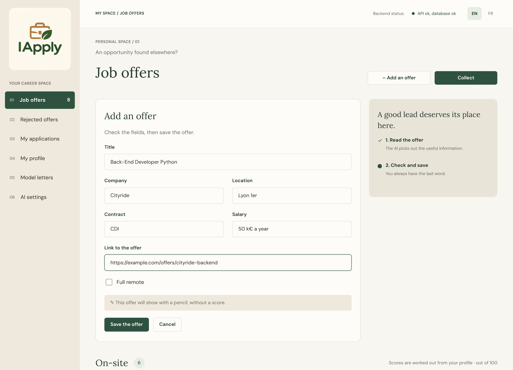
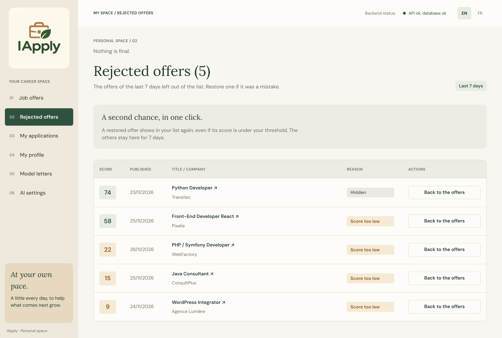
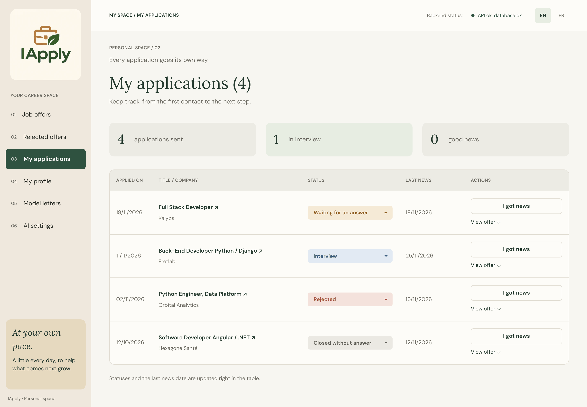
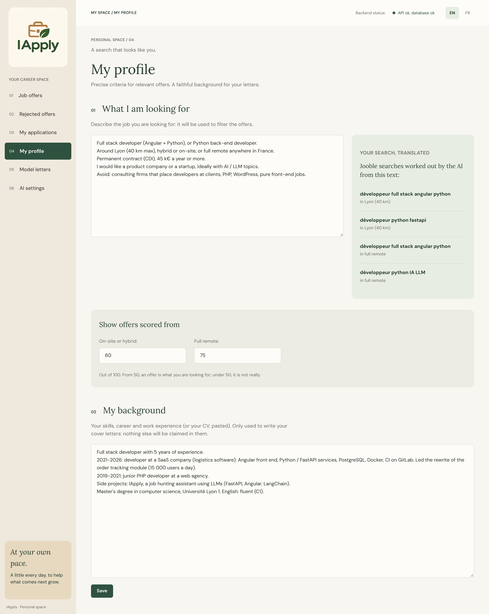
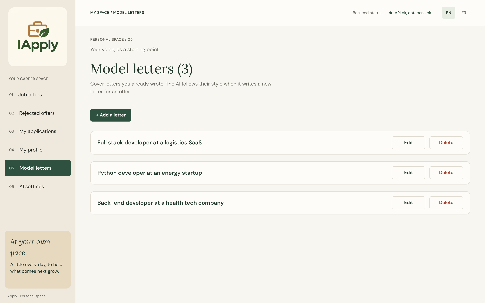
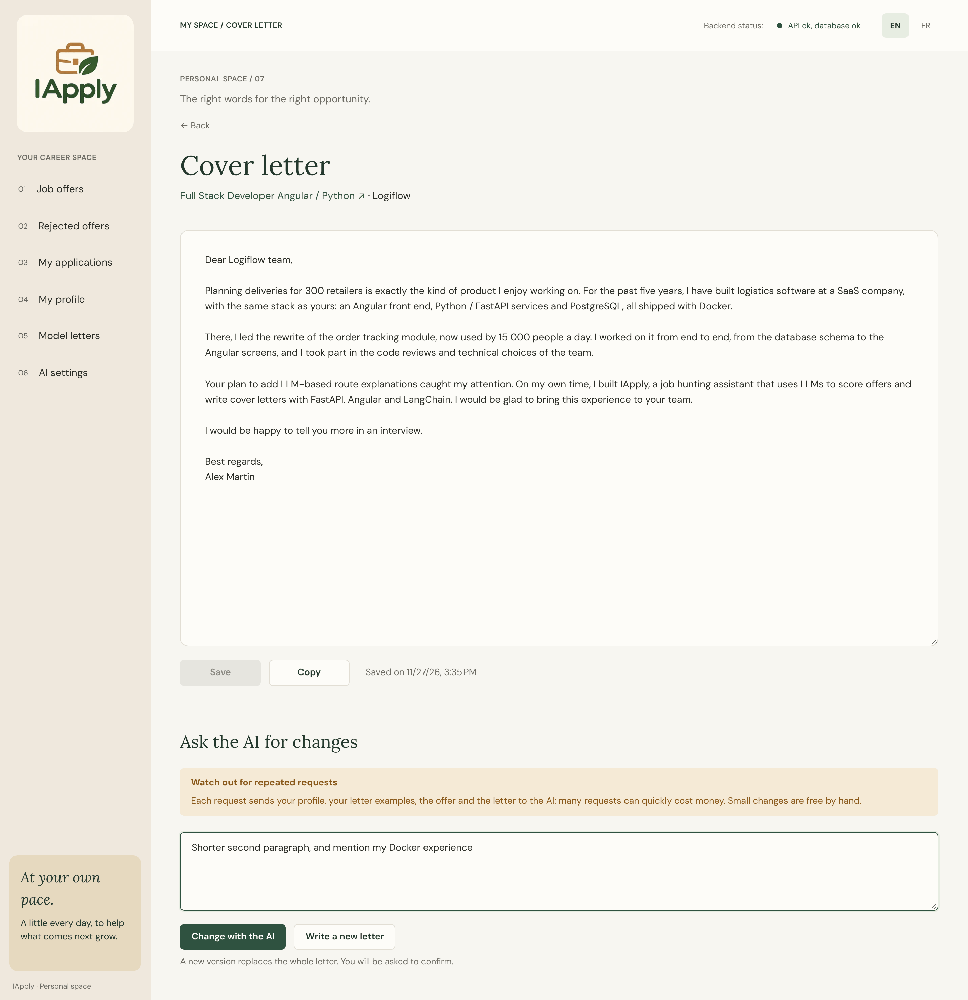
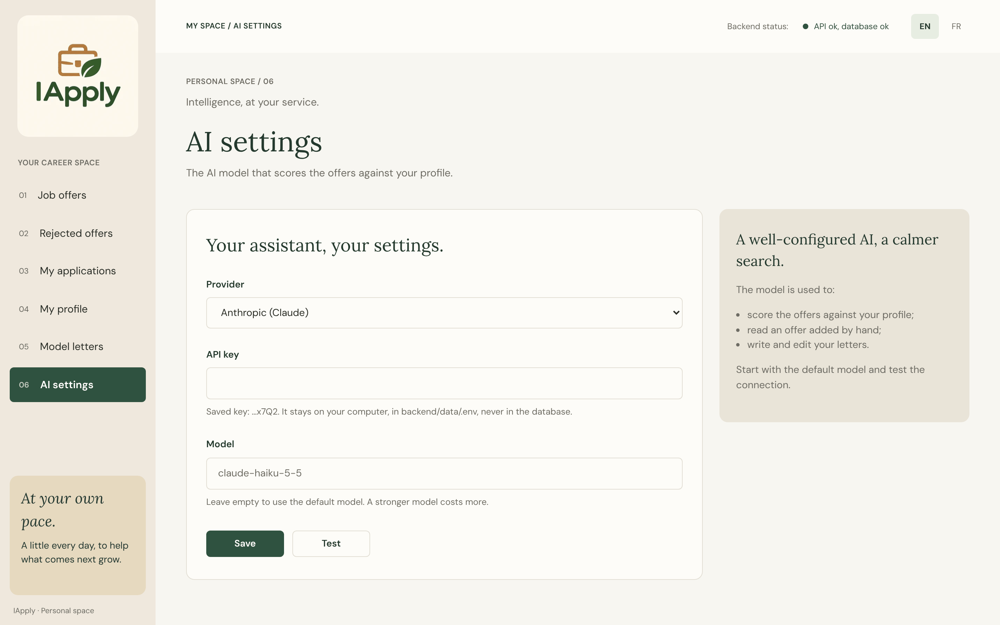
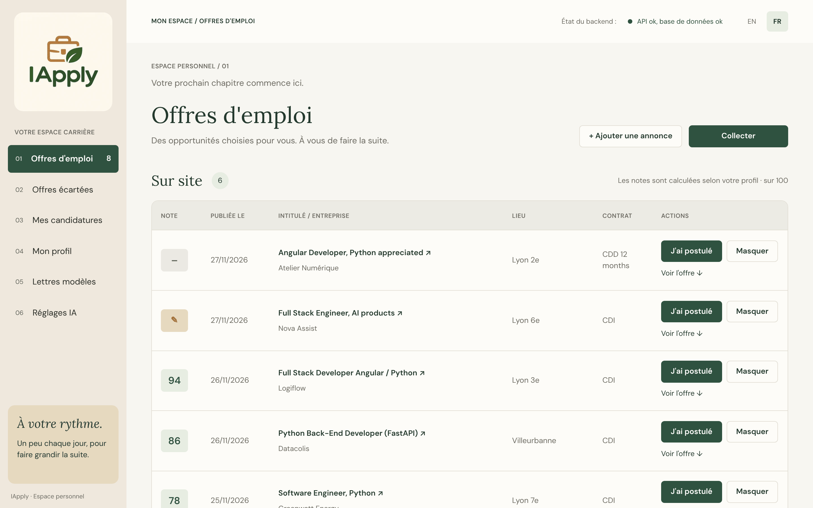

# IApply

IApply is a personal job hunting assistant powered by AI. It collects job offers every day, scores each one against what you are looking for, hides the ones that do not fit, keeps track of your applications and writes your cover letters in your own style.

It is built for one person, runs on your own computer with Docker, and works with the AI provider of your choice (OpenAI, Anthropic, Google Gemini or Mistral). The interface is available in English and French.
See the roadmap in [DECISIONS.md](DECISIONS.md#2026-11-25--roadmap-update).



## Why IApply

Job boards send back far too many offers, and most of them have little to do with what you are looking for. Reading them all takes hours every week. IApply does that first reading for you: you describe the job you want in a few sentences, and the AI turns it into searches, scores every offer it finds, and only shows you the ones worth your time. Then it helps you with the next steps: the cover letter and the follow-up of each application.

## Features

### Job offers, collected and scored for you

One click on "Collect" fetches the offers published since the last collection from the Jooble job API, which gathers offers from many French job boards. The searches themselves are worked out by the AI from your profile, so there are no keywords to set by hand.

Each new offer then gets a score from 0 to 100: 80 and more is the job you would love, 50 to 79 is a job you are also looking for, and under 50 is not really what you want. Offers are listed from the best score to the lowest, with on-site and full remote offers in two separate lists. Each row links to the original posting.

From the list, you can mark an offer as applied (it moves to your applications), hide it, or open its details.

### Offer details

"View offer" unfolds the offer under its row: location, contract, salary and the full text of the offer. Job APIs only give a short snippet, so you can paste the full text of the original posting here. It is what the AI uses to write a good cover letter, and it stays available later, when you prepare an interview.



### Add an offer found elsewhere

Found an interesting offer on LinkedIn or a company website? Paste its text and its link. The AI reads the offer and fills in the title, company, location, contract, salary and remote fields. You check them, correct them if needed, and save. The offer then joins your list, marked with a pencil instead of a score, and gets the same features as the others.



### Rejected offers

Nothing disappears for good. Offers scored under your threshold, and offers you hid, are kept on the "Rejected offers" page for 7 days, with the reason they were left out. If the AI got one wrong, or you hid one by mistake, one click brings it back to your list.



### Application tracking

Every offer you applied to lands on the "My applications" page, with the date you applied, its status (waiting for an answer, interview, rejected, accepted, closed without answer) and the date of the last news. The status is changed right in the table, and the "I got news" button records a follow-up without changing it. An application with no news for a month is closed automatically, so the list stays up to date without effort. The offer and its full text are one click away, which is handy before an interview.



### Your profile

The profile is plain text, in your own words. In "What I am looking for", you describe the job, technologies, location, remote, contract and what to avoid. When you save it, the AI turns it into up to 6 job searches (keywords around a city, or full remote), shown next to the text.

You also choose two score thresholds: one for on-site or hybrid offers, and one for full remote offers, since a remote job may need to be a better match (or a lesser one) to be worth it.

"My background" holds your skills, career and work experience, or your pasted CV. It is only used to write your cover letters, and the AI never claims anything that is not written there or in your model letters.



### Model letters

Add the cover letters you already wrote. The AI follows their style and tone when it writes a new letter, and can reuse the facts they contain about you.



### Cover letters

Once an offer has its full text, IApply writes a cover letter for it, in the language of the offer, from your background, your model letters and the offer itself. The letter has its own page where you can:

- edit it by hand and copy it,
- ask the AI for changes in plain words, for example "shorter second paragraph, mention my Docker experience",
- or have a whole new letter written.

To keep costs low, the AI does not rewrite the whole letter for a change: it only sends back the pieces of text to replace, and IApply applies them. The page also warns you that many AI requests can add up.



### AI settings

Choose your AI provider (OpenAI, Anthropic, Google Gemini or Mistral), paste your API key, and optionally type another model than the default one: a stronger model gives better results, a smaller one costs less. A "Test" button checks the connection. The API key stays on your computer, in a local file, and is never stored in the database.



### English and French

The whole interface switches between English and French at any time, without reloading the page.



The screenshots above show demo data: the companies and offers are made up.

## Stack

| Part | Technology |
|---|---|
| Backend | Python, FastAPI, SQLModel, Alembic, LangChain |
| Frontend | Angular |
| Database | PostgreSQL |
| Runtime | Docker Compose (frontend, backend, db) |

See [DECISIONS.md](DECISIONS.md) for why each choice was made.

## Project layout

```
IApply/
├── backend/    # FastAPI application (API, database, job sources, LLM calls)
├── frontend/   # Angular application (user interface)
├── docker-compose.yml  # Runs the database, backend and frontend together
└── DECISIONS.md
```

## Getting started

Requirements: Docker Desktop.

```bash
docker compose up --build
```

Then open:

- http://localhost:4200: the app, showing "Backend status: API ok, database ok"
- http://localhost:8000/health: the API directly, answering `{"status": "ok", "database": "ok"}`
- http://localhost:8000/docs: the API documentation

Settings live in `.env` (copy `.env.example` to `.env`): database credentials and
the Jooble key and host. Without a
`.env`, the defaults from `docker-compose.yml` are used, but collecting offers
needs at least `JOOBLE_API_KEY`.

## Collecting job offers

1. Get a free Jooble API key from the French page, https://fr.jooble.org/api/about
   (a key only works on the host of its country), and put it in `.env` as
   `JOOBLE_API_KEY`.
2. Choose an LLM on the **LLM** page, then describe what you are looking for on the
   **Profile** page and save: the LLM works out the Jooble searches from it.
3. Open http://localhost:4200 and click **Collect**. It fetches the offers published
   since the latest one already saved (7 days back the first time), saves the new
   ones and lists them, on-site and remote apart, each linking to the original posting.

The free key allows 100 calls a day; one collection uses about 6 to 10.

API routes: `POST /jobs/collect` runs a collection, `GET /jobs` lists the saved offers.

## Your profile

The **Profile** page holds what you are looking for, as plain text (job, technologies,
location, remote, contract, what to avoid). The LLM scores the offers against it and, when
you save a new text, works out from it the Jooble searches of the collection (at most 6,
each one a few keywords around a place, or full remote). They are listed under the text.
If the LLM fails, nothing is saved and the page shows why.

API routes: `GET /profile` reads it, `PUT /profile` saves it, `GET /profile/searches` lists the
Jooble searches.

To run without Docker, see [backend/README.md](backend/README.md) and
[frontend/README.md](frontend/README.md).
